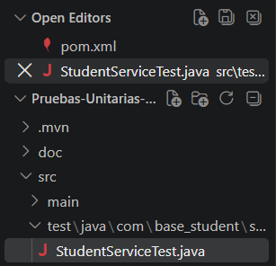
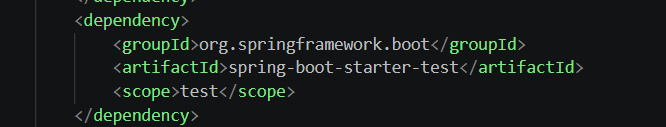
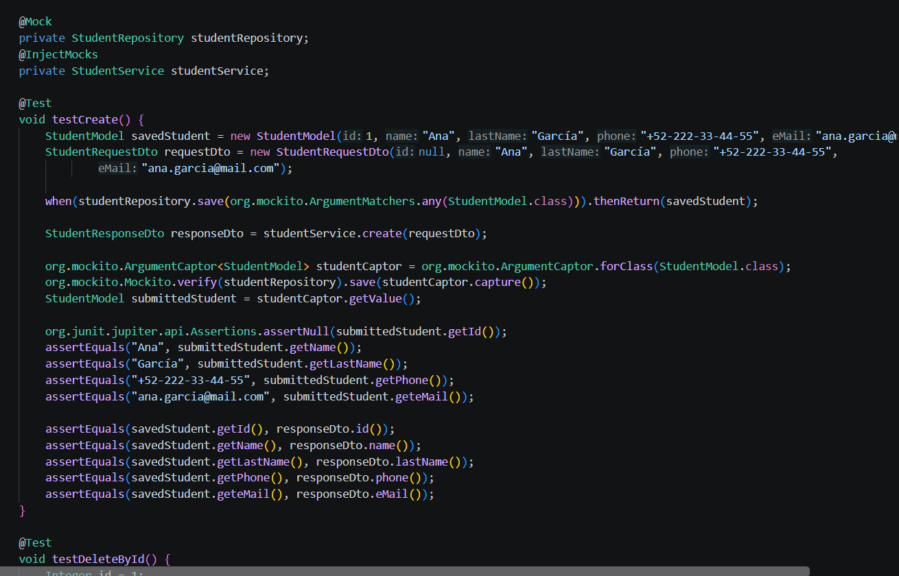
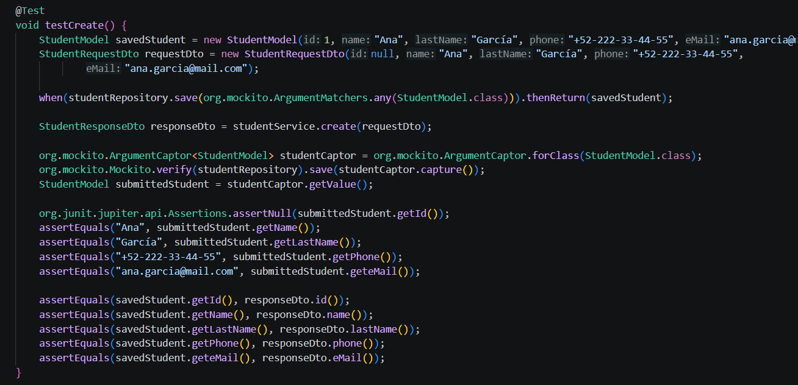
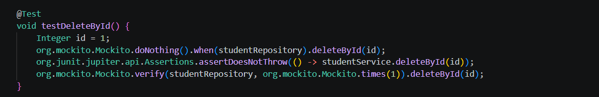
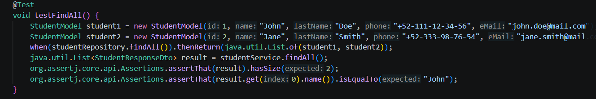
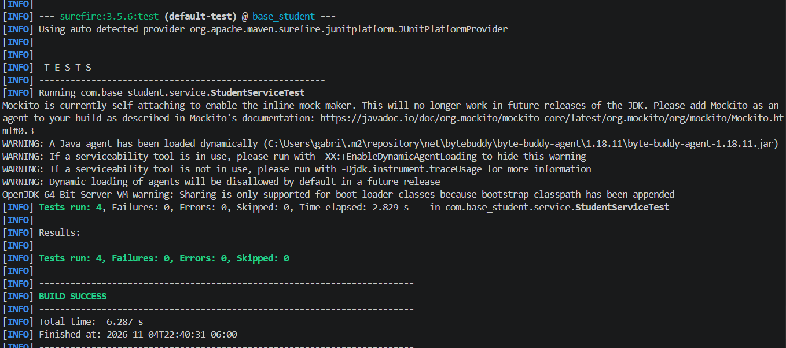

# Estructura del proyecto y código fuente

Se estableció la arquitectura base del proyecto en el entorno de desarrollo de Visual Studio Code, separando de manera estricta el código fuente de la aplicación (src/main) del directorio correspondiente a la suite de pruebas unitarias (src/test), garantizando una distribución limpia y estandarizada de los componentes del sistema.

Dentro del archivo de configuración del gestor de dependencias (pom.xml), se incorporó formalmente la dependencia spring-boot-starter-test bajo el alcance (scope) de pruebas. Esta integración permitió habilitar el motor de ejecución de JUnit 5, las herramientas de simulación de entornos y las utilidades de aserción requeridas para el desarrollo de la práctica.

Se desarrolló la clase de pruebas unitarias (StudentServiceTest.java) para validar las operaciones de la capa de lógica de negocio de forma aislada, para lograrlo: 

- Se empleó la anotación @Mock para simular el comportamiento del repositorio de datos y @InjectMocks para gestionar la inyección en el servicio.  

- Se implementó un ArgumentCaptor dentro del método de prueba testCreate para interceptar, extraer e inspeccionar detalladamente los atributos del modelo (nombre, apellido, teléfono y correo) antes de que se ejecute la operación de persistencia, asegurando la integridad de los datos procesados.

# Pruebas unitarias
Para validar el correcto funcionamiento de la lógica de negocio en la capa de servicios de manera aislada, se implementó la clase StudentServiceTest utilizando JUnit 5, Mockito y AssertJ. A continuación se detallan las pruebas unitarias desarrolladas:

Esta prueba valida el proceso de creación de un nuevo estudiante. Se simula la respuesta del repositorio mediante when .thenReturn  y se implementa un ArgumentCaptor<StudentModel> para interceptar el objeto exacto que se envía a la base de datos. Esto permite comprobar detalladamente que los atributos (nombre, apellido, teléfono y correo electrónico) se asignen correctamente y que la respuesta devuelva el DTO esperado.

Esta prueba verifica la correcta eliminación de un registro por su identificador (id). Se configura el comportamiento simulado con doNothing() y se utiliza assertDoesNotThrow() para garantizar que la ejecución del método de borrado no arroje excepciones inesperadas. Finalmente, se emplea verify para confirmar que el método del repositorio fue invocado exactamente una vez.

Esta prueba comprueba la recuperación exitosa de todos los registros de estudiantes. Se simula el método findAll() para que devuelva una lista con dos elementos de prueba. Luego, se hace uso de las declaraciones fluidas de AssertJ para validar que la cantidad de elementos recuperados sea correcta y que los datos del primer registro coincidan plenamente.

# Ejecución exitosa

Se llevó a cabo la ejecución de la suite de pruebas unitarias mediante la terminal utilizando el comando mvn test con el gestor de dependencias Maven. Como se observa en el reporte de consola, el proceso finalizó de manera óptima mostrando el mensaje BUILD SUCCESS, con un total de 4 pruebas ejecutadas de forma exitosa, reportando 0 fallos, 0 errores y 0 pruebas omitidas, lo que valida el cumplimiento total de los requerimientos de la práctica.

